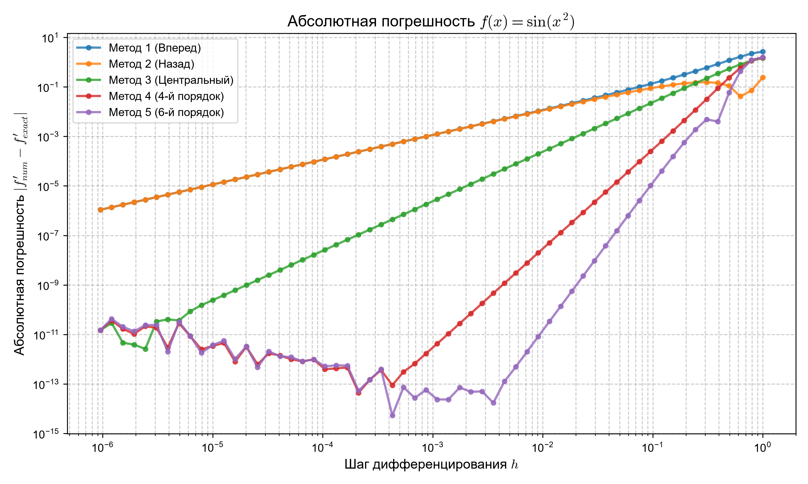
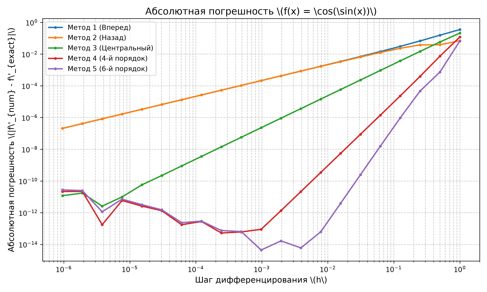
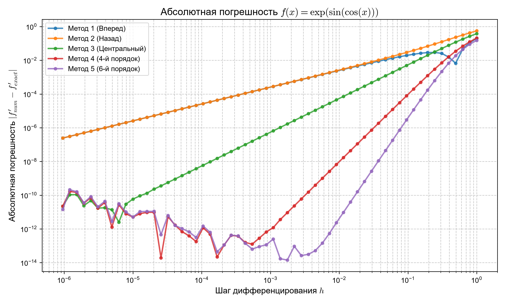
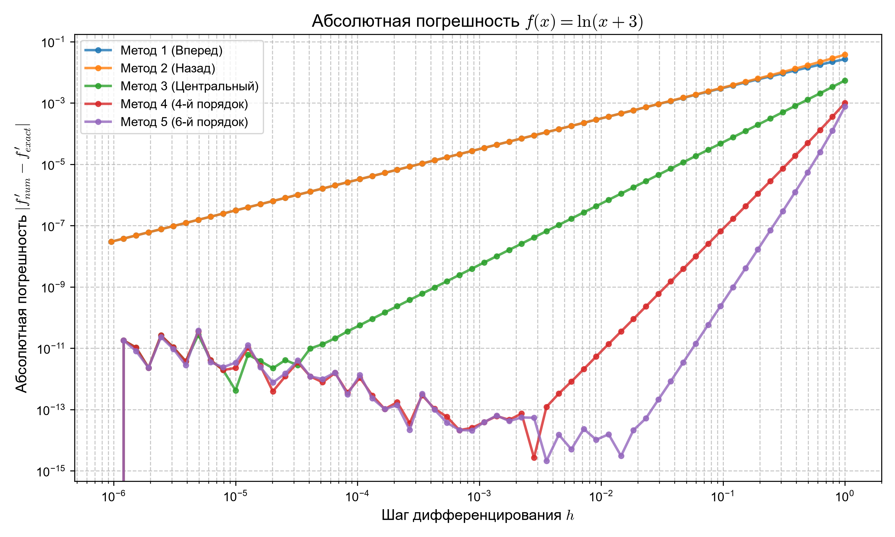
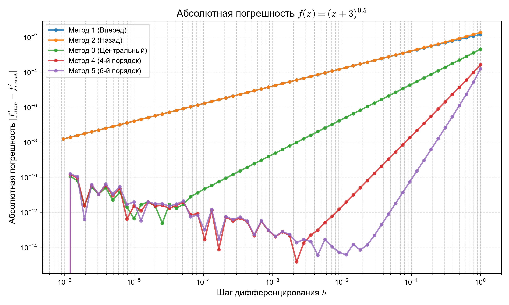

# Лабораторная работа №1: Численное дифференцирование

##  Цель работы
Исследование зависимости абсолютной погрешности различных методов численного дифференцирования от величины шага \(h\). Построение графиков в логарифмическом масштабе.

##  Задание
Для функций:
1. $f(x) = \sin(x^2)$
2. $f(x) = \cos(\sin(x))$
3. $f(x) = \exp(\sin(\cos(x)))$
4. $f(x) = \ln(x+3)$
5. $f(x) = (x+3)^{0.5}$

Необходимо вычислить значения первой производной в заданной точке с помощью пяти методов и сравнить их с аналитическим значением.

Шаг дифференцирования задается формулой: \(h_n = \frac{2}{2^n}\), где \(n \in [1, 21]\).

##  Используемые методы
1. $$\frac{f(x+h) - f(x)}{h}$$
2. $$\frac{f(x) - f(x-h)}{h}$$
3. $$\frac{f(x+h) - f(x-h)}{2h}$$
4. $$\frac{4}{3}\frac{f(x+h)-f(x-h)}{2h} - \frac{1}{3}\frac{f(x+2h)-f(x-2h)}{4h}$$
5. $$\frac{3}{2}\frac{f(x+h)-f(x-h)}{2h} - \frac{3}{5}\frac{f(x+2h)-f(x-2h)}{4h} + \frac{1}{10}\frac{f(x+3h)-f(x-3h)}{6h}$$

##  Как запустить
1. Установите библиотеки:
   ```bash```
   ```pip install numpy matplotlib```
  
2. Запустите скрипт из папки с лабораторной:
    ```python main.py```
## Результаты работы

На графиках ниже по обеим осям используется логарифмический масштаб (log-log).

1. Функция $$\f(x)=\sin(x^2)


   

2. Функция $$\f(x)=\cos(\sin(x))
   

   

3. Функция $$\f(x)=\exp(\sin(\cos(x)))


   

4. Функция $$\f(x)=\ln(x+3)


   

5. Функция $$\f(x)=(x+3)^{0.5}


   

## Вывод
 Мы видим что при возрастании порядка уго наклона графика увеличивается, но при этом размер шага при котором уже начинает влияь машинная погрешность уменьшается (Разварот графика начинается раньше).   