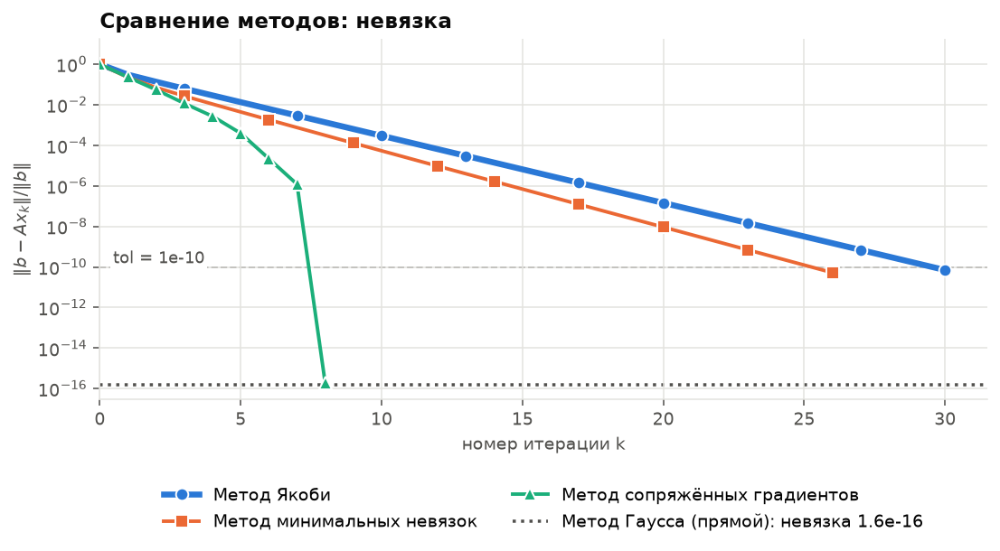
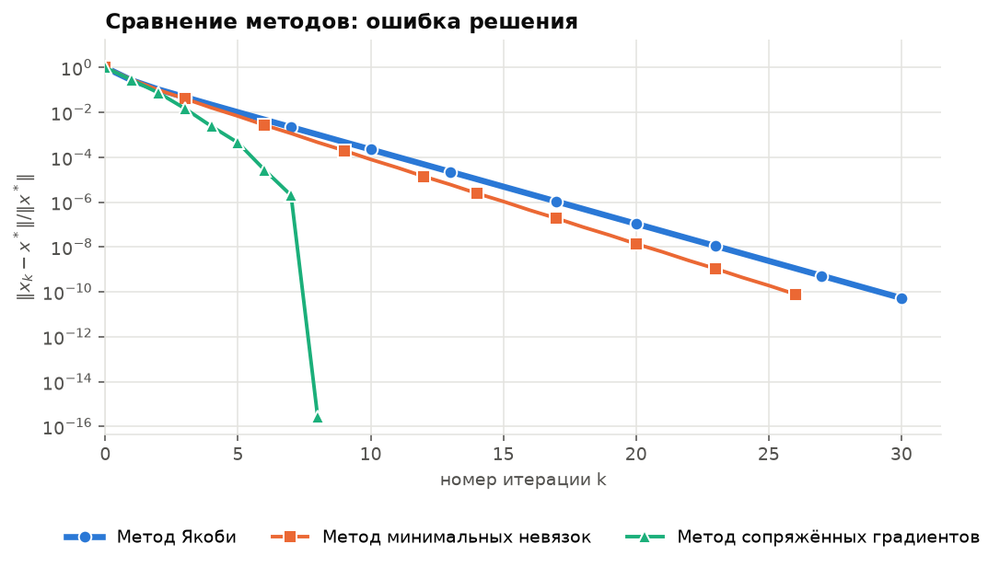
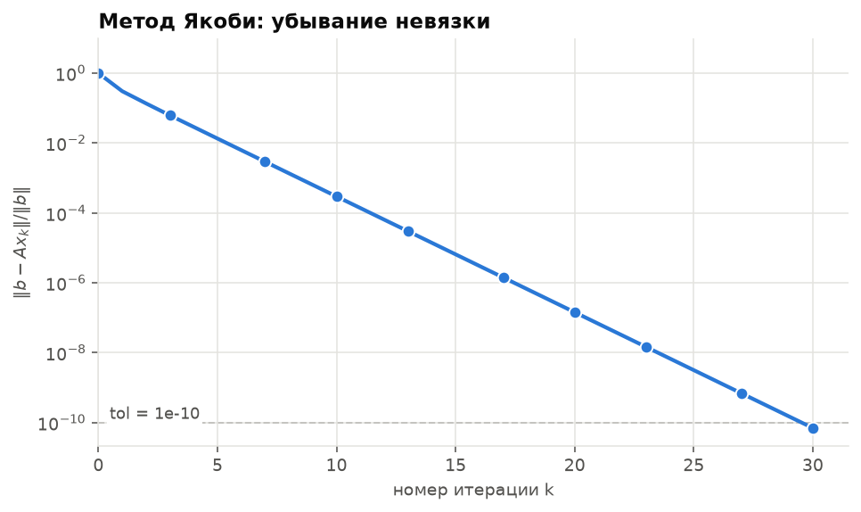
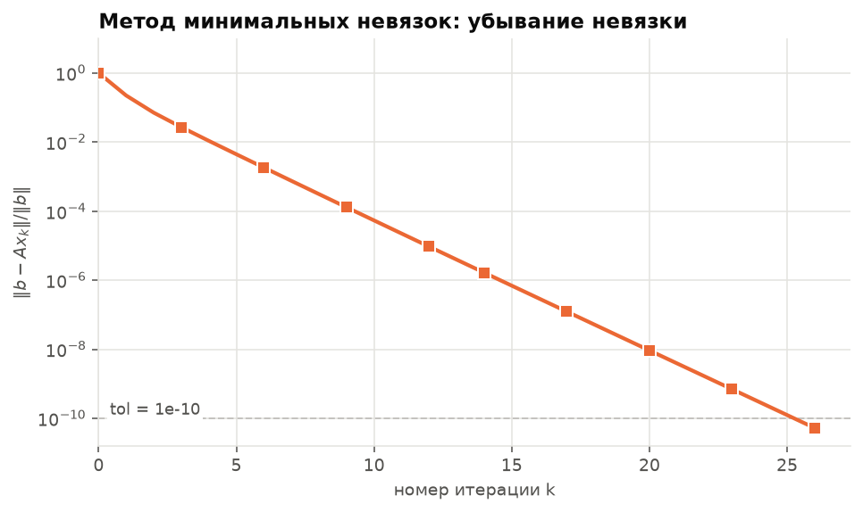
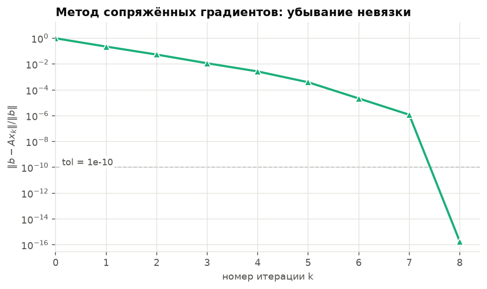

# Лабораторная работа: численное решение СЛАУ

Вариант **«о»**, методы (выбраны генератором случайных чисел, `seed = 473354`):

| № в списке | Метод | Ключ в коде |
|---|---|---|
| 3 | Метод Якоби | `jacobi` |
| 7 | Метод минимальных невязок | `mr` |
| 8 | Метод сопряжённых градиентов (CG) | `cg` |
| 1 | Метод Гаусса с выбором главного элемента (прямой, **эталон для сверки**) | `gauss` |

Метод Гаусса не входил в случайную тройку: я добавил его как прямой метод, с которым сверяются итерационные.

> ⚠️ **Важно про данные.** Матрица и правая часть варианта «о» из методички мне не передавались, поэтому в `systems/variant_o.json` лежит **заглушка**: случайная симметричная система 8×8 со строгим диагональным преобладанием (она гарантированно подходит всем трём методам). Чтобы получить свой вариант, замените `A` и `b` в этом файле и перезапустите программу, больше ничего менять не нужно (см. раздел «Как задать свою СЛАУ»).

## Запуск

```bash
pip install numpy matplotlib
python slau_lab.py                                  # система из systems/variant_o.json
python slau_lab.py --system poisson:n=50 --tol 1e-6 --tag poisson_n50
```

Графики сохраняются в папку `pictures/`, в консоль выводится диагностика матрицы и итоговая таблица.

## Архитектура

Итерационные методы устроены одинаково: это **генератор итераций** `метод(A, b, x0, **параметры)`, который отдаёт очередное приближение `x_k`. Они регистрируются декоратором `@register` в словаре `METHODS`. Прямые методы (сейчас `gauss`) проще: функция `(A, b) -> x`, регистрируется через `@register_direct` в словаре `DIRECT`. Единая функция

```python
solve(A, b, method, x0=None, tol=1e-10, max_iter=10_000, x_exact=None, **params) -> Result
```

сама считает истинную невязку `‖b − A x_k‖ / ‖b‖`, ошибку относительно точного решения, проверяет критерий остановки и защищается от расходимости. Параметры конкретного метода передаются через `**params`:

```python
solve(A, b, "jacobi", omega=0.8)     # демпфированный Якоби
solve(A, b, "cg", tol=1e-12)
solve(A, b, "gauss")                 # прямой метод: сразу готовое решение
```

Из командной строки: `--methods gauss,cg,jacobi` (по умолчанию `gauss,jacobi,mr,cg`), `--param jacobi.omega=0.8`, `--tol`, `--max-iter`.

**Как добавить метод** (Зейдель, SOR, градиентный спуск, BiCGStab, LU…): написать ещё один генератор (или функцию для прямого метода) и повесить на него `@register("имя", "Название")` (`@register_direct` для прямого). Ни `solve`, ни графики, ни CLI трогать не нужно.

### Как сверяться

Решение метода Гаусса считается эталоном `x*`. Ошибка итерационных методов `‖x_k − x*‖ / ‖x*‖` считается относительно него. Сам Гаусс (написан вручную) проверяется независимо: его решение сравнивается с `numpy.linalg.solve` (LAPACK), результат сверки печатается при каждом запуске. На графиках невязки прямой метод показан горизонтальной пунктирной линией: это точность, которую в принципе можно получить в арифметике с плавающей точкой для данной системы.

### Как задать свою СЛАУ

Параметр `--system` принимает:

- путь к JSON: `{"name": "...", "A": [[...], ...], "b": [...]}`;
- `random:n=30,seed=1`: случайная СПД диагонально доминирующая система;
- `poisson:n=50`: трёхдиагональная матрица (2, −1), дискретизация `−u'' = f`.

Точное решение для оценки ошибки берётся из `numpy.linalg.solve`.

## Методы

- **Гаусса с выбором главного элемента (прямой):** на шаге `k` из столбца берётся элемент с наибольшим модулем, строка переставляется наверх, ниже диагонали всё обнуляется; затем обратная подстановка. Даёт решение за конечное число операций (≈ `2n³/3`), выбор главного элемента защищает от деления на малое число; для вырожденной матрицы метод сообщает об ошибке.
- **Якоби:** `x_{k+1} = D⁻¹ (b − (A − D) x_k)`. Сходится, если спектральный радиус матрицы перехода `ρ(−D⁻¹(A − D)) < 1` (например, при строгом диагональном преобладании). Скорость ≈ `ρ`.
- **Минимальные невязки:** `r_k = b − A x_k`, `τ_k = (r_k, A r_k) / (A r_k, A r_k)`, `x_{k+1} = x_k + τ_k r_k`. Шаг минимизирует `‖r_{k+1}‖₂`. Сходится, если симметричная часть `A` положительно определена; для СПД-матрицы невязка убывает не медленнее, чем со знаменателем `(κ − 1)/(κ + 1)`.
- **Сопряжённых градиентов:** для СПД-матриц; направления `A`-сопряжены, в точной арифметике метод даёт точное решение не более чем за `n` шагов. Оценка скорости по энергетической норме ошибки: `(√κ − 1)/(√κ + 1)`.

В графиках и таблицах невязка считается **заново** как `b − A x_k` на каждой итерации (а не по рекуррентной формуле метода), поэтому она честно отражает точность решения.

## Результаты

### 1. Система варианта «о» (заглушка 8×8)

Диагностика: симметрична, положительно определена, строгое диагональное преобладание, `κ₂(A) ≈ 2.47`, `ρ(Якоби) ≈ 0.466`, поэтому применимы все три метода.

| Метод | Итераций до `tol = 1e-10` | Итоговая невязка | Ошибка решения | Средний множитель за итерацию |
|---|---|---|---|---|
| Гаусса (прямой) | — | 1.6·10⁻¹⁶ | 1.7·10⁻¹⁶ (относительно numpy) | — |
| Якоби | 30 | 7.0·10⁻¹¹ | 5.3·10⁻¹¹ | 0.459 |
| Минимальные невязки | 26 | 5.2·10⁻¹¹ | 7.9·10⁻¹¹ | 0.402 |
| Сопряжённые градиенты | 8 | 1.8·10⁻¹⁶ | 2.8·10⁻¹⁶ | 0.011 |





Невязка каждого метода по отдельности:







**Выводы.**

- Якоби и MR убывают линейно (прямая на полулогарифмическом графике). Наблюдаемый множитель Якоби (0.459) близок к `ρ = 0.466`; MR (0.402) укладывается в оценку `(κ − 1)/(κ + 1) = 0.424`.
- Гаусс совпадает с `numpy.linalg.solve` до машинной точности, его невязка (~10⁻¹⁶) задаёт нижний предел точности. Якоби и MR остановлены раньше, по `tol`, а CG за 8 шагов доходит именно до этого предела.
- CG сходится на порядки быстрее и приходит к машинной точности ровно за `n = 8` шагов, как и предсказывает теория. Кривая CG не прямая, а «обрывается» вниз: это свойство метода, его невязка не обязана убывать монотонно.

### 2. Плохо обусловленная система (одномерная задача Пуассона, n = 50)

Чтобы разница между методами была видна, а не «все сошлись за 30 итераций», я дополнительно прогнал систему `poisson:n=50`: `κ₂(A) ≈ 1053`, строгого диагонального преобладания нет, `ρ(Якоби) ≈ 0.9981`. Критерий остановки `tol = 1e-6`.

| Метод | Итераций | Средний множитель за итерацию |
|---|---|---|
| Гаусса (прямой, невязка 3.1·10⁻¹⁴) | — | — |
| Якоби | 7227 | 0.9981 |
| Минимальные невязки | 7057 | 0.9980 |
| Сопряжённые градиенты | 25 | невязка достигла 0, множитель не определён |


**Выводы.**

- Якоби и MR требуют тысяч итераций, их скорость определяется числом обусловленности: множитель `≈ 1 − 2/κ`.
- CG справляется за 25 итераций, а не за 50. Правая часть `b = (1, …, 1)` симметрична, поэтому подпространство Крылова содержит только симметричные собственные векторы, и их всего 25.
- Ось X на графиках сравнения здесь составная: линейная до k = 10, дальше логарифмическая (иначе 25 итераций CG слились бы с началом координат). Нулевую невязку на логарифмической оси нарисовать нельзя, поэтому последняя точка CG показана на условном уровне 10⁻¹⁷ с подписью «ровно 0»: это не реальное значение, а отметка о том, что `b − A x` обнулилось.
- Невязка CG на первых шагах **растёт** (до ~5·‖b‖), прежде чем упасть. Это нормально: CG минимизирует не невязку, а A-норму ошибки.

## Структура проекта

```
slau_lab.py            # весь код: системы, методы, solve, диагностика, графики, CLI
systems/variant_o.json # СЛАУ варианта «о» (сейчас заглушка, замените на свою)
pictures/              # все сгенерированные графики
README.md
```

Цвета графиков взяты из проверенной на различимость (в том числе при дальтонизме) категориальной палитры; по оси Y везде логарифмический масштаб.