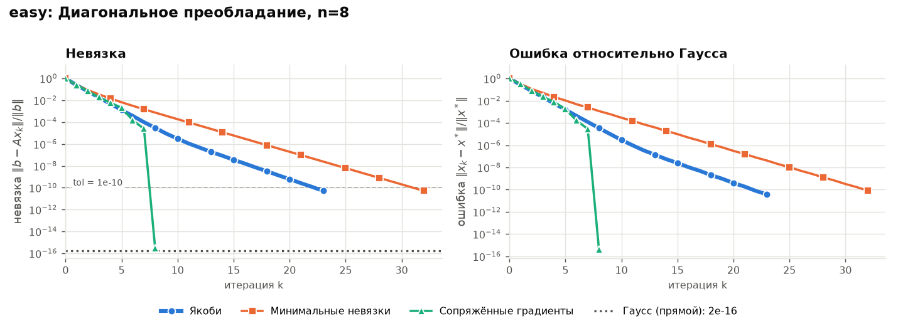
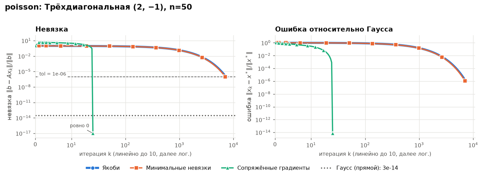
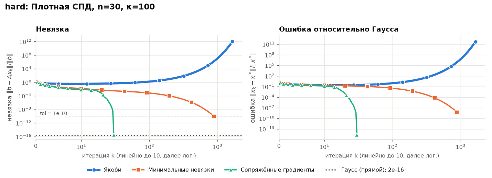

# Лабораторная 2. Решение СЛАУ

Решаем `A x = b` четырьмя методами и сравниваем сходимость по невязке (логарифмическая шкала).

| Метод | Тип | Ключ | Применим, если |
|---|---|---|---|
| Гаусс с выбором главного элемента | прямой, **эталон** | `gauss` | `A` невырождена |
| Якоби | итерационный | `jacobi` | `ρ(D⁻¹(A−D)) < 1`, напр. диагональное преобладание |
| Минимальные невязки | итерационный | `mr` | симметричная часть `A` положительно определена |
| Сопряжённые градиенты (CG) | итерационный | `cg` | `A` симметрична и положительно определена |

## Запуск

```bash
pip install numpy matplotlib
python main.py        # все системы -> графики в pictures/
```

Выбор системы и методов: `--system poisson`, `--methods gauss,cg`, `--tol 1e-12`, `--param jacobi.omega=0.8`.

## Результаты

Число итераций до `‖b − Ax‖/‖b‖ < tol` (`tol = 1e-10`, для `poisson` — `1e-6`):

| Метод | `easy` n=8 | `poisson` n=50 | `hard` n=30 |
|---|---|---|---|
| Гаусс | прямой | прямой | прямой |
| Якоби | 23 | 7227 | расходится |
| Минимальные невязки | 32 | 7057 | 886 |
| CG | **8** | **25** | **30** |
| *κ(A)* | 3 | 1050 | 100 |

Слева на графиках невязка, справа ошибка относительно решения Гаусса. Пунктир внизу — невязка самого Гаусса, то есть предел точности для данной системы.

**`easy`:** диагональное преобладание, сходятся все. CG заканчивает за `n = 8` шагов.


**`poisson`:** плохая обусловленность, Якоби и MR нужны тысячи итераций, CG — 25.


**`hard`:** плотная СПД-матрица без диагонального преобладания. `ρ(Якоби) = 1.018 > 1`, поэтому Якоби расходится; MR и CG сходятся.


## Выводы

- Скорость MR (и Якоби на `poisson`) определяется обусловленностью: множитель за шаг ≈ `1 − 2/κ` при больших `κ`. CG быстрее на порядки и в точной арифметике завершается не более чем за `n` шагов.
- Якоби требует `ρ < 1`; CG и MR диагонального преобладания не требуют.
- Невязка CG не монотонна (на `poisson` сначала растёт): метод минимизирует A-норму ошибки, а не невязку.
- Гаусс совпадает с `numpy.linalg.solve` до ~10⁻¹⁶ (сверка печатается при запуске).

## Своя система или метод

Своя СЛАУ — JSON `{"A": [[...]], "b": [...]}`: `python main.py --system my.json`.
Новая система во встроенный набор — одна строка в словаре `SYSTEMS` в `main.py`.

Новый метод — одна функция с декоратором, всё остальное (`solve`, графики, CLI) подхватит его само:

```python
@register("seidel", "Зейдель")
def seidel(A, b, x0, **params):
    x = x0.copy()
    while True:
        ...            # один шаг метода
        yield x        # отдаём очередное приближение
```
