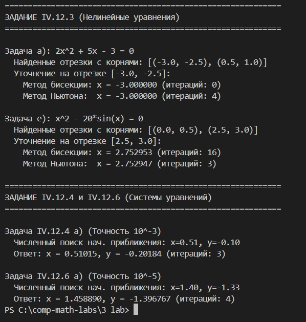

# Решение нелинейных уравнений и систем уравнений

Проект содержит скрипт на Python для автоматического поиска (отделения) корней и их уточнения с заданной точностью для заданий IV.12.3, IV.12.4 и IV.12.6.

## 1. Как происходит численный поиск корней (Отделение корней)

Вместо ручного построения графиков, скрипт использует метод **сканирования сетки (Grid Search)**.

### Для одного уравнения \(f(x) = 0\) (Задание IV.12.3):
Мы проходим по оси X с заданным шагом `step`. Если функция на текущем шаге и на следующем шаге имеет разные знаки (то есть \(f(x) \cdot f(x + step) < 0\)), это означает, что график пересек ось X. Этот интервал \([x, x+step]\) сохраняется как отрезок, содержащий корень.

### Для системы уравнений (Задание IV.12.4 и IV.12.6):
Мы создаем двумерную сетку значений \(x\) и \(y\). В каждой точке мы вычисляем "невязку" — сумму квадратов обоих уравнений системы:
\(R(x,y) = (f_1(x,y))^2 + (f_2(x,y))^2\).
Точка, в которой невязка минимальна, берется как начальное приближение для метода Ньютона.

## 2. Методы уточнения решений

После того как найдены интервалы и начальные точки, применяются итерационные методы:

*   **Метод половинного деления (Бисекция)** — используется для уравнений. Отрезок делится пополам, выбирается та половина, где функция меняет знак. Надежен, но медленный.
*   **Метод Ньютона (Касательных)** — используется и для уравнений, и для систем. Для систем требует вычисления матрицы Якоби (первых производных). Обладает очень быстрой (квадратичной) сходимостью.

## 3. Выбранные задачи и точность

| Задание | Уравнение / Система | Метод поиска | Метод уточнения | Точность (\(\varepsilon\)) |
| :--- | :--- | :--- | :--- | :--- |
| **IV.12.3 а** | \(2x^2 + 5x - 3 = 0\) | Сканирование | Бисекция и Ньютон | \(10^{-5}\) |
| **IV.12.3 е** | \(x^2 - 20\sin(x) = 0\) | Сканирование | Бисекция и Ньютон | \(10^{-5}\) |
| **IV.12.4 а** | \(\sin(x+1) - y = 1.2\)<br>\(2x + \cos(y) = 2\) | Сетка 2D | Ньютон (система) | \(10^{-3}\) |
| **IV.12.6 а** | \(2x^2 - xy - 5x + 1 = 0\)<br>\(x + 3\lg(x) - y^2 = 0\) | Сетка 2D | Ньютон (система) | \(10^{-5}\) |

## 4. Запуск

1. Установите библиотеку `numpy`, если она еще не установлена:
   ```bash```
   ```pip install numpy```
2. Запустите скрипт:
   ```python main.py```

## 5. Пример работы программы

